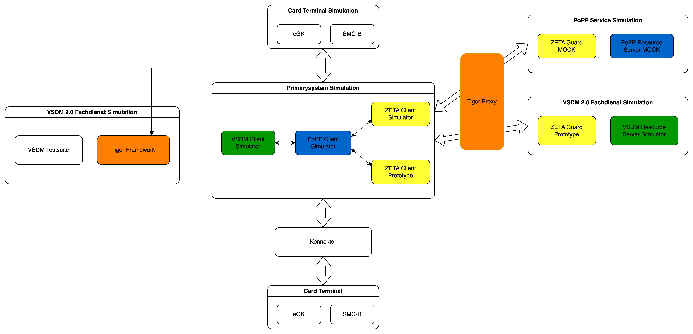

== References

=== Environment Variables

Each service can be configured via environment variables. Key configuration options:

==== Client Services

- `POPP_HTTP_URL` - PoPP service HTTP URL
- `VSDM_RESOURCE_SERVER_URL` - VSDM service HTTP URL

[#dockerComposeProfiles]
=== Docker Compose Profiles

Testhub supports different startup profiles for various use cases:

[cols="1,3", options="header"]
|===
| Profile
| Description

| `full`
| Backend + Tiger-Proxies + Clients via proxy. Use this for normal development and testing.

| `backend-only`
| Backend services only (no Tiger-Proxies, no clients). Use this when you want to run your own client implementation against the backend.
|===

==== The `full` Profile – Requests via Tiger Proxy

The `full` profile represents the standard development and testing setup. All traffic between the
clients (VSDM Client, Card Terminal Client) and the backend services is routed through the **Tiger
Proxy**, which records every HTTP request and response for later analysis (see
xref:traffic.adoc#inspectClusterTraffic[]). A second proxy instance – the **TI-Connect Tiger Proxy**
– handles the simulated TI-Connect path.

.Architecture of the `full` profile
image::diagrams/full_profile.png[Architecture diagram showing clients routing traffic through Tiger Proxy to the backend, width=900]

Key characteristics of the `full` profile:

* The Tiger Proxy acts as a man-in-the-middle recorder – requests are visible
  in the Tiger UI and stored in the `.tgr` traffic files.
* All Tiger Proxy instances (frontend, backend, TI-Connect) are started.
* The OpenTelemetry Collector, Prometheus, and Grafana are included for
  observability.
* Suitable for functional feature-testing, debugging, and contract (Pact) verification.


=== Useful links

**ZETA**

* link:https://gemspec.gematik.de/docs/gemSpec/gemSpec_ZETA/latest/[ZETA Specification]
* link:https://gematik.github.io/zeta/[ZETA SDK User Manual]
* link:https://github.com/gematik/zeta[ZETA GitHub Repository]
* link:https://gemspec.gematik.de/docs/gemILF/gemILF_ZETA_API/latest/[Implementation Guide ZETA Client]

**PoPP**

* link:https://gemspec.gematik.de/docs/gemSpec/gemSpec_PoPP_Service/latest/[gemSpecPages PoPP-Service Release Documentation]
* link:https://github.com/gematik/spec-ilf-popp-client/tree/main[PoPP-Client Implementation Guide GitHub Repository]
* link:https://github.com/gematik/popp-sample-code[PoPP-Sample Implementation GitHub Repository]
* link:https://github.com/gematik/popp-token-generator[PoPP token generator GitHub Repository]

**VSDM2**

* link:https://gemspec.gematik.de/docs/gemSpec/gemSpec_VSDM_2/latest/[gemSpecPages VSDM 2.0 Documentation]
* link:https://github.com/gematik/spec-VSDM2/tree/main[VSDM 2.0 GitHub Repository]
* link:https://simplifier.net/vsdm2/~introduction[VSDM 2.0 FHIR Specification]

=== Architecture Diagram

This diagram shows components matching Testhub Stufe 2:



=== Service Descriptions

|===
| Service                  |  Purpose

| **Card Terminal Client** |  Simulates electronic health card (eGK, SMC-B, HBA) terminal operations with PACE protocol support
| **VSDM Client**          | Simulates VSDM2 client operations including data retrieval and PoPP token validation
| **ZETA PEP PoPP**        |  Policy Enforcement Point proxy for PoPP validates tokens and forwards requests
| **ZETA PDP PoPP**        |  Policy Decision Point for PoPP performs OAuth 2.0 token exchange (RFC 8693)
| **PoPP Server**          |  Backend PoPP service generates and validates Proof of Possession tokens
| **VSDM Server**          |  Backend VSDM service provides VSDM2 data from YAML test fixtures
| **Tiger Proxy UI**       |  Local Tiger Proxy between PS-Simulation and PoPP and VSDM-Servers
|===

The services are exposed on different ports to the local environment. To access
the containers when applicable, use the following script to find the host port
mapping:

```bash
docker ps --format 'table {{.Names}}\t{{.Ports}}'
```
